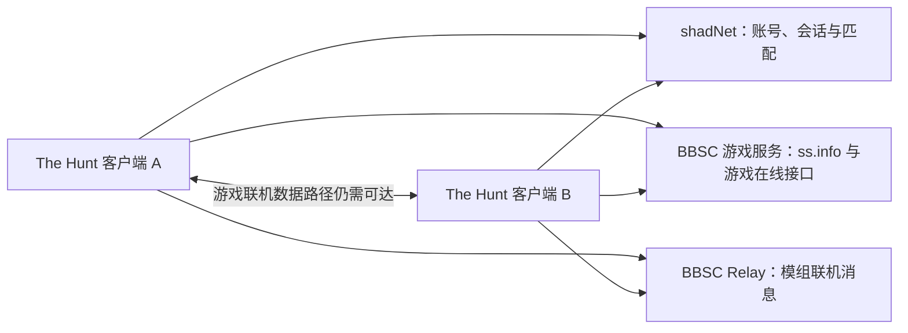

# 服务端说明

本文说明 The Hunt 使用的 **Ubuntu + Docker Compose + Tailscale + shadNet + BBSC 游戏服务/Relay**。客户端入口见[联机地址](https://github.com/ytq77/TheHuntLauncher/blob/main/docs/network.md)。

整理日期：2026-10-20（香港时间）。依据是此前私服部署文件、固定版本源码及双人实测记录。本次文档整理没有修改正在运行的服务器。

## 阅读顺序

1. 新建服务器：[部署教程](deployment.md)。
2. 已有服务器：[维护、备份与升级](operations.md)。
3. 登录或召唤失败：[分层排错](troubleshooting.md)。
4. 可下载的构建与配置材料：[部署配方](../recipe/)。

## 几个组件分别做什么

这些连接通过管理员选定的局域网或 Tailscale 网络建立。连接上服务器、通过账号认证，并不等于玩家之间的连接已经建立。Relay 也不代表所有游戏流量都会通过云服务器中转。

| 组件 | 作用 | 本教程 BBSC 端口 |
|---|---|---|
| shadNet 主服务 | 玩家账号会话、世界/房间、匹配与信令 | TCP 31413 |
| shadNet STUN | 发现客户端的网络端点 | UDP 31414 |
| shadNet WebAPI | 账号接口与游戏召唤接口 | TCP 31415，HTTP |
| BBSC 游戏服务 | 提供 `ss.info`，告知游戏各在线接口的地址 | TCP 20443，HTTP |
| BBSC Relay | BBSC 模组的额外同步消息 | TCP 20444 |

`20443` 在这套部署中使用 **HTTP**。数字看起来像 HTTPS 端口，并不意味着应该填写 `https://`。

## 普通联机和无缝联机

此前的普通联机环境使用另一套 shadNet，端口为 TCP 31313、UDP 31314、TCP 31315；游戏在线服务另行配置。BBSC 使用独立数据库、状态目录和 314xx 端口，方便保留普通联机环境。

| 项目 | 普通联机环境 | 本教程 BBSC 环境 |
|---|---|---|
| 主服务 / STUN / WebAPI | 31313 / 31314 / 31315 | 31413 / 31414 / 31415 |
| 游戏在线服务 | 普通启动器所选服务 | 自建 BBSC 游戏服务 20443 |
| 模组 Relay | 本教程不为普通联机配置 | 20444 |
| 客户端 | 普通 BBport | The Hunt 独立包 |
| 账号数据 | 普通联机数据库 | BBSC 独立数据库 |

端口相邻不代表可以混用。两个数据库里的同名账号也不是同一份账号记录。每位同时在线的玩家应使用不同账号，且两人都连接同一套 BBSC 服务。

这套方案使用自己的 shadNet 账号，不要求 Discord 登录。BBSC 游戏服务存储的是本服务产生的数据，不会自动与 The Hunter's Dream 公共服务器的留言、血迹或账号数据同步。固定版本源码中已有留言、血迹等处理，但并非所有原版在线功能都有完整实现；不能把标题界面进入在线当作全部功能验收。

## 固定的兼容基线

| 项目 | 来源 / 版本 |
|---|---|
| 客户端基线 | The Hunt / BBport 1.9.4，游戏 CUSA03173 1.09 |
| shadNet | `Wozzardman/shadnet-p2p`，`5a849a192fd4450593c57b10697316ac324c856e` |
| shadNet 本地补丁 | 同时接受旧 4 字节与客户端 6 字节 STUN 报文头，并按请求格式回包 |
| BBSC 游戏服务 | `CLSAMG22/BBSC`，`315f76c38b1ca5843b082f93f47927a9193ad94a` |
| BBSC 服务调整 | 增加显式 `--shadnet-webapi`，把召唤接口指向独立的 31415；本机登录 URL 使用实际监听地址 |
| 服务模式 | `--no-bbhost --no-playlog`；不启用另一套 bbhost 后端 |

STUN 补丁来自实际排错：原服务能接收旧格式，却丢弃了两台客户端发送的新格式报文。修复后，历史记录中出现了端点登记、对端地址查询和客机入房，玩家确认能够互相看见并正常战斗。它不构成“所有网络问题都已修复”的保证。

## “自建镜像”是什么意思

镜像把编译好的程序及运行库打包，Docker 根据镜像启动容器。此前私服使用的是在该服务器本地构建的镜像，`local/...` 是本地标签，不是可从公共仓库下载的地址。

本教程附带源码准备、补丁、Dockerfile 与配置模板，目标是让管理员能构建自己的同类镜像。目前没有提供公共服务端镜像，也没有服务端自动更新任务。Windows 启动器的 GitHub Release 不包含正在运行的私服、账号数据库或已配置好的服务器。

## 验证范围

- **已有实测记录**：之前部署的 STUN 修复镜像通过独立报文测试；兼容基线完成两人移动、战斗、死亡后保持连接和提灯同行。
- **本次公开材料**：整理源码来源、校验值、端口、配置模板和操作步骤；检查公开材料不带私人地址、账号或数据库。
- **仍待验证**：目标 Linux 主机的网络与双人端到端复验；最新启动器完整双人回归和 Boss 战结束后的联机保持。公开配方的干净构建和协议检查已由 GitHub CI 完成。

现有私服可继续使用，不需要为了阅读或发布教程而重建。实际测试记录见[验证范围](validation.md)。
